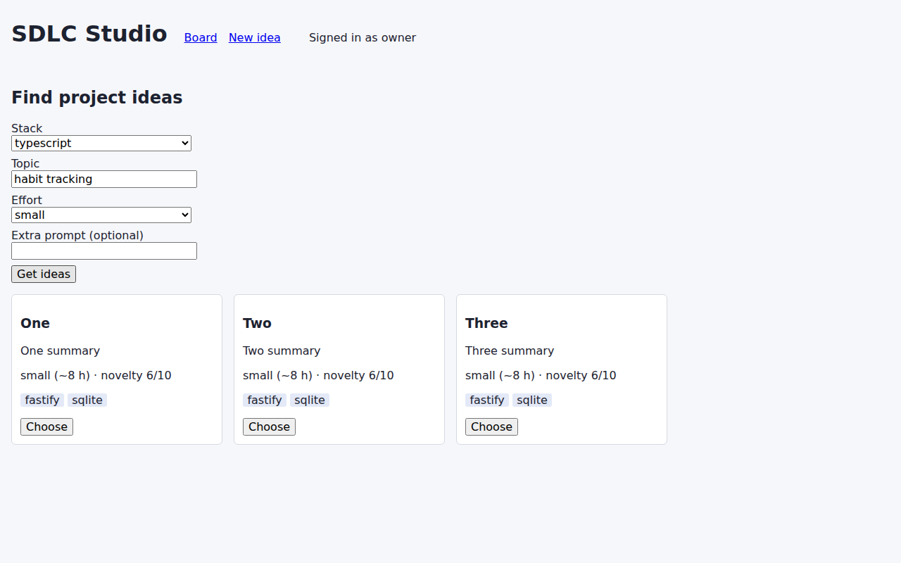
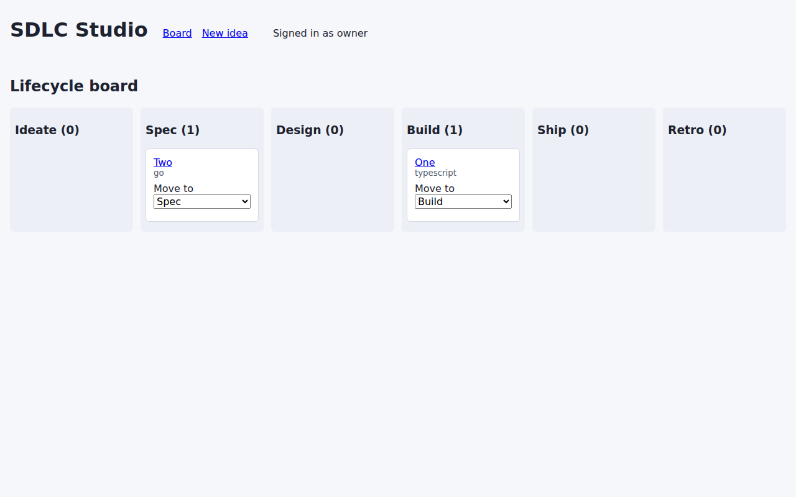
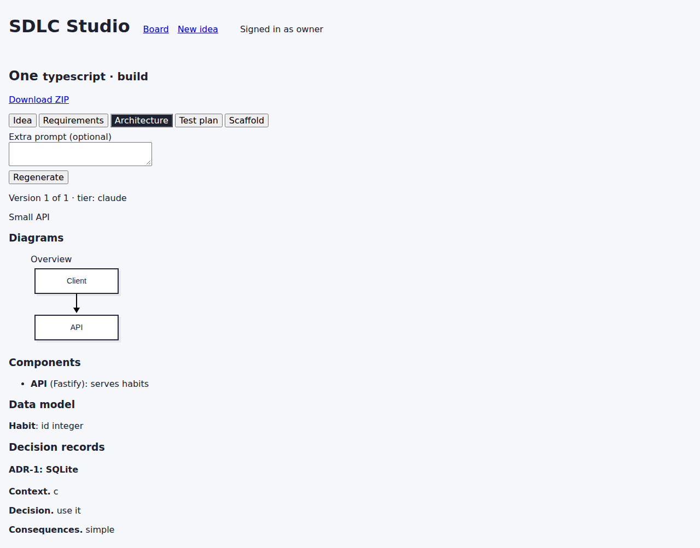
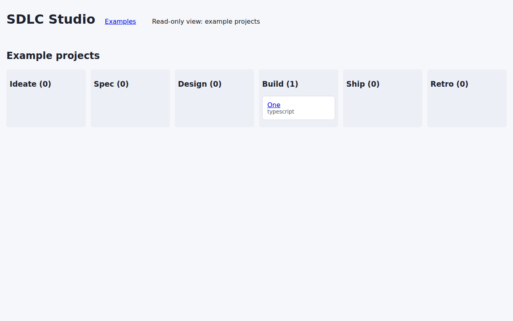

# sdlc-studio

Pick a stack and topic, get scored project ideas, and take one through requirements, architecture, test plan and
a code scaffold. Generation runs through the homelab LLM router; the app holds no Claude API key. Saved example
projects can be browsed read-only by visitors on the tailnet.

## Screenshots
| Ideas | Lifecycle board |
| --- | --- |
|  |  |

| Project view (architecture with a rendered Mermaid diagram) | Visitor (read-only examples) |
| --- | --- |
|  |  |

The screenshots were taken against the real backend with a stubbed router.

## Frontend
Vue 3 + Vite in `frontend/src`, no router or store library:
- `api.ts`: typed client; failures become an `ApiError` carrying the server's message.
- `route.ts`: hash routes `#/board` (default), `#/ideas`, `#/project/:id`.
- `views/IdeasView.vue`: stack, topic, effort form and idea cards with a Choose action.
- `views/ProjectView.vue`: a tab per stage, generate/regenerate with an optional extra prompt, version history, tier
  per version, ZIP download. A failed generation shows an error and leaves every stored version on screen.
- `views/BoardView.vue`: six lifecycle columns; the owner moves a project with the "Move to" select (a `PATCH`, so it
  survives a reload).
- Visitor mode: `GET /api/me` reports the role. For a visitor the app only lists example projects (the API already
  filters them) and renders no generate, edit or move controls; the server refuses those calls anyway (403).
- Mermaid is loaded on demand (`components/MermaidDiagram.vue`, strict security level), so it only costs bytes on the
  architecture tab.

## Architecture note
The browser talks only to the Fastify API (`/api`, proxied by Vite in development). The API owns the SQLite store,
the append-only artifact versions and the role check; every generation goes through the homelab LLM router and
records its tier. The frontend holds no secrets and no generation logic. See
[docs/architecture.md](docs/architecture.md).

## Run
```sh
npm ci
cp .env.example .env   # then export the variables, or set them in your service unit
npm run build
node backend/dist/main.js            # API on http://127.0.0.1:8110
npm run dev -w frontend              # UI on http://127.0.0.1:5173, proxies /api
```
Open the UI as the owner by sending `Authorization: Bearer $SDLC_OWNER_TOKEN` (for example through a header-injecting\nbrowser extension) or behind Tailscale Serve; without it you see the visitor view.

Checks: `npm run lint`, `npm run typecheck`, `npm test`, `npm run build` (the same as CI). Needs Node 24.

## Configuration
| Variable | Default | Meaning |
| --- | --- | --- |
| `SDLC_HOST` | `127.0.0.1` | Bind address; wildcard addresses are refused unless `SDLC_ALLOW_WILDCARD_BIND=1` |
| `SDLC_PORT` | `8110` | Port |
| `SDLC_ROUTER_URL` / `SDLC_ROUTER_TOKEN` | `http://127.0.0.1:8018` / empty | Homelab LLM router |
| `SDLC_OWNER_IDENTITIES` | empty | Comma separated Tailscale logins treated as owner |
| `SDLC_OWNER_TOKEN` | empty | Bearer token that grants owner access (CLI skill, scripts) |
| `SDLC_DB_PATH` | `./data/sdlc-studio.db` | SQLite file |

## Network
Only reachable through Tailscale, never from the internet. See [docs/architecture.md](docs/architecture.md).
